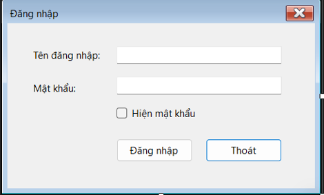
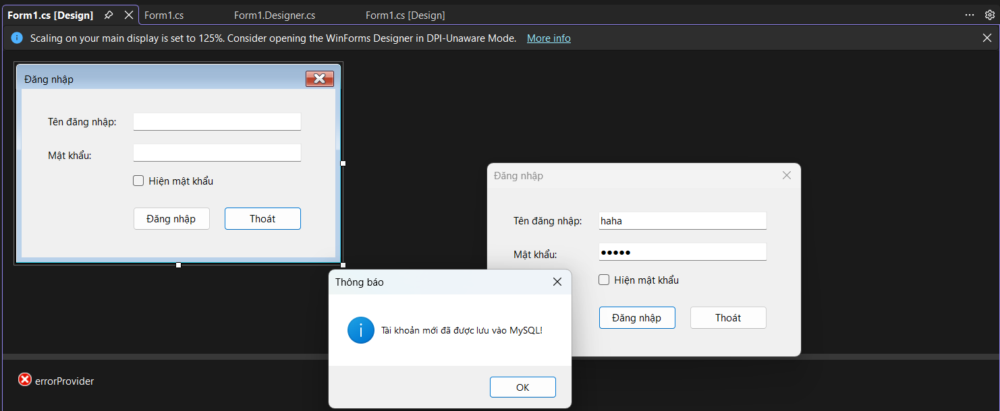
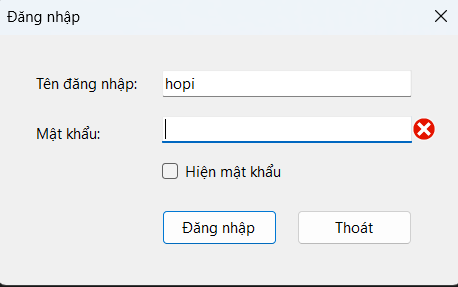
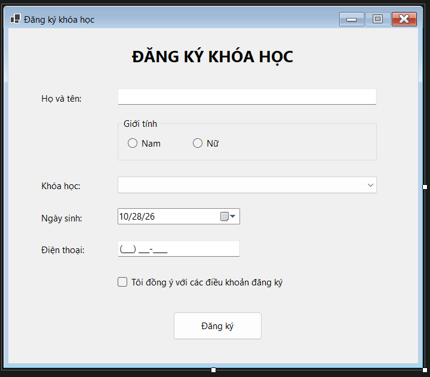
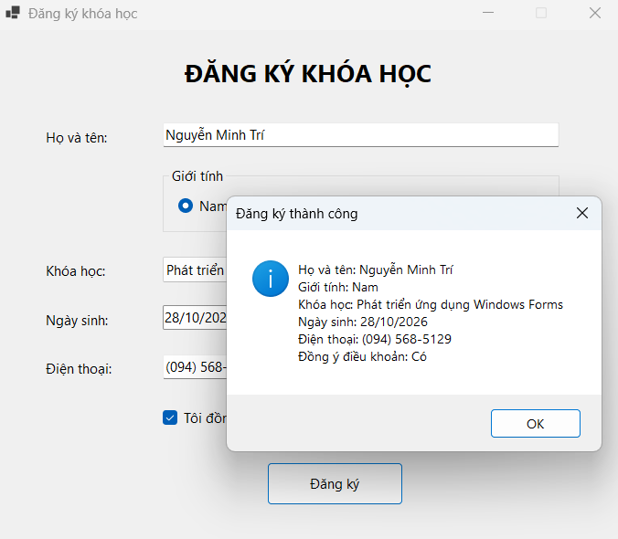
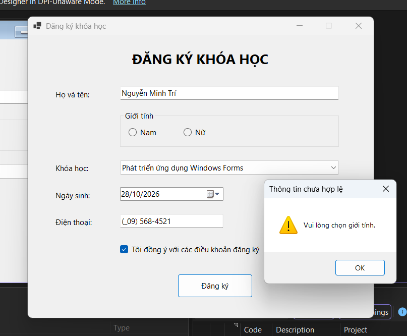

# BÁO CÁO BÀI TAP 5.1 - 5.2

## I. THÔNG TIN SINH VIÊN
* **Họ và tên:** Nguyễn Minh Trí
* **Mã số sinh viên:** 24810320227
* **Lớp: D19QTANM1**
* **Lớp học phần:** Lập trình .NET 
* **Link Repository:** https://github.com/familo23/Baitap5.1-5.2-NguyenMinhTri-/tree/main

---

## II.  KẾT QUẢ THỰC HÀNH

### Bài 5.1
### 1. Ảnh màn hình Giao diện chính

### 2. Ảnh màn hình kết quả

---------
.png)
---------

### 3. Ảnh màn hình Kiểm tra lỗi (Validation)

---
### Bài 5.2:
### 1. Ảnh màn hình Giao diện chính

### 2. Ảnh màn hình kết quả

---------

### 3. Ảnh màn hình Kiểm tra lỗi (Validation)

---
.png)

